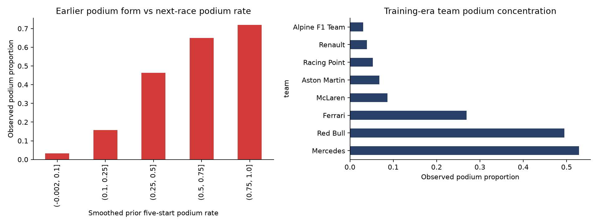
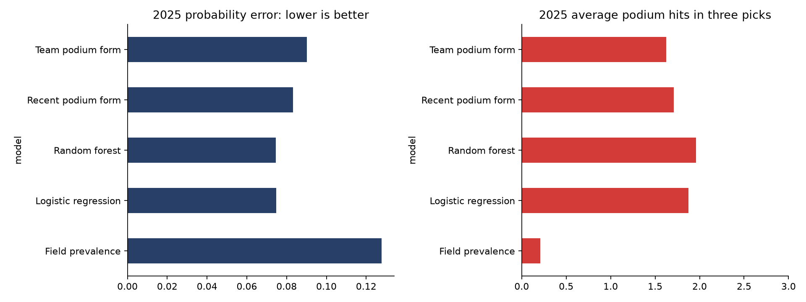
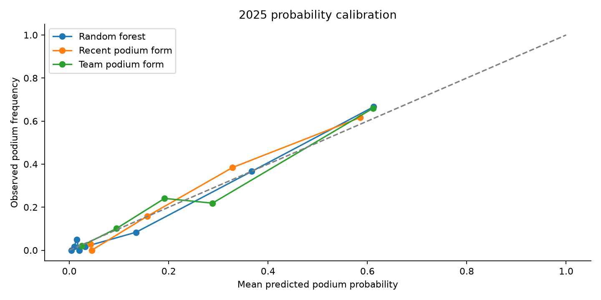
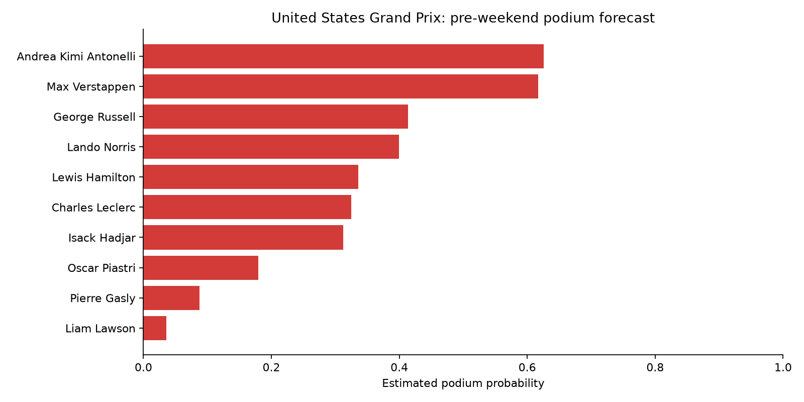

# Formula 1 Podium Forecast: Can Data Improve on Recent Form?

The last race gives fans an instinct about who looks strong. This project tests whether historical performance can turn that instinct into better **next-race podium probabilities**, using FastF1 and a chronological backtest.

**Finding:** in the primary 2025 evaluation, Random forest averaged **1.96 correct podium picks out of three**, versus **1.71** for a recent-driver-form rule. Its Brier probability error was **0.075**, versus **0.083**—approximately **10.5% lower**. Paired race-bootstrap intervals supported lower probability error against both form baselines in this sample. This is evidence from a retrospective backtest, not a guarantee of future performance.

## 1. Define a forecast that can be tested

The question is: **Can historical driver and team performance improve next-race podium forecasts beyond simple rules, and how reliable are those forecasts?**

The first edition forecasts before the race weekend. Each driver receives a podium probability, and the top three form a shortlist. Ranking by podium likelihood is **not an exact finishing-order prediction**. The scope deliberately excludes current-weekend qualifying and practice, which would belong to a separate post-qualifying edition.

## 2. Collect and inspect historical races

FastF1's Ergast interface retrieves race results from Jolpica-F1. This snapshot contains **3,832 driver-race rows across 190 races**, from 2018 through completed 2026 events. Sprint outcomes are excluded. The target is official classified position 1–3, including the source's treatment of non-finishers.

Pagination is handled explicitly, duplicate driver-race keys are checked, and every race must contain three podium finishers. Raw season snapshots and a provenance manifest support reproducibility. The most recent downloaded race is **Singapore Grand Prix on 2026-10-11**; the next scheduled race is **United States Grand Prix on 2026-10-25**. The cutoff is **2026-10-12**.

**Why this helps:** a forecast built on an incomplete or stale race table is unreliable before modeling begins. The pipeline refuses to produce a forecast if results for the latest scheduled completed race are missing.

## 3. Turn past performance into pre-race evidence

Features summarize prior five-start driver finish, grid position, podium frequency, and completion; prior ten driver-start team form; current-season podium frequency; and previous circuit results. Finish/grid metrics are normalized by field size. Available history and experience expose how much evidence exists for each driver.

Grid history measures past starting positions, including penalties—not upcoming qualifying. Unknown history receives neutral defaults and smoothed podium rates rather than zero-risk assumptions. Driver/team states update only after **every** driver in a race receives pre-race features. Tests verify that changing a race's outcomes leaves that race's features unchanged, while correctly changing later features.

**Why this helps:** the model learns from information that could exist at forecast time. It cannot improve its apparent accuracy by using the result it is meant to predict.

## 4. Explore patterns before choosing models

Training-era EDA uses 2019–2023, with 2018 warming up rolling histories. The notebook compares earlier podium-form groups with next-race outcomes and examines team podium concentration. Counts accompany rates so sparse groups are visible.



**Interpretation:** historical form and team strength contain useful information, but an association does not establish causality. Their predictive value also makes them demanding baselines: a complex model should improve on these simple signals.

## 5. Compare methods under chronological evaluation

- **Field prevalence:** 3 divided by the entrant count; no driver-specific information.
- **Recent podium form:** a smoothed prior-five-start podium rate.
- **Team podium form:** a smoothed prior-ten-driver-start team podium rate.
- **Logistic regression:** an additive model of podium log-odds using standardized features.
- **Random forest:** 120 constrained trees capturing nonlinear relationships and interactions, maximum depth 6 and minimum leaf size 15.

Before each backtested race, models train only on earlier races. Race participants remain together; preprocessing is fitted to training data. Models have fixed settings and no extensive tuning search. **2024 selects the learned method using mean race-level Brier score; 2025 is the primary later evaluation; 2026 is reported separately.** Models refit as earlier races become available, mirroring rolling use.

The 2024 Brier scores were 0.09079 for random forest and 0.09081 for logistic regression. That tiny development difference selects random forest by the stated rule; it does not establish a meaningful advantage over logistic regression.

## 6. Answer the forecasting question

| Method | 2025 Brier error ↓ | Correct podium picks out of 3 ↑ | Exact podium set |
|---|---:|---:|---:|
| Field prevalence | 0.128 | 0.21 | 0.0% |
| Recent podium form | 0.083 | 1.71 | 16.7% |
| Team podium form | 0.090 | 1.62 | 4.2% |
| Logistic regression | 0.075 | 1.88 | 16.7% |
| Random forest | 0.075 | 1.96 | 12.5% |



Brier score measures squared probability error; lower is better. Correct podium picks measures the average number of actual podium drivers in a three-driver shortlist. Exact podium set requires all three, irrespective of order. Field-prevalence ties are broken alphabetically, so its shortlist score is not a random-selection benchmark. Randomly selecting three of N entrants has expected 9/N podium hits.

**Interpretation:** the selected model improves both probability error and average podium capture over the driver/team form baselines in 2025. However, it identifies the complete podium set in only **12.5% of races**. More correct individual picks does not mean reliably predicting all three. Logistic regression is very close in probability error and has a higher exact-set rate in this sample, so the project does not establish that random forest dominates every metric.

The 2025 model-minus-recent-form Brier difference is approximately **−0.0087**, with a paired race-bootstrap 95% interval of **−0.0137 to −0.0036**. Against team form, the difference is **−0.0157**, with an interval of **−0.0221 to −0.0099**. Resampling whole races preserves within-race dependence. These intervals support the sample comparison but omit uncertainty from all analytical choices and future changes.

## 7. Check reliability, explanations, and failures



Calibration compares predicted probabilities with observed podium frequencies in bins. The diagonal represents agreement; above it indicates underestimated podium frequency and below it overestimation. The plot should be read with Brier and log loss, rather than used to certify individual probabilities. This version does not fit a separate calibration model.

A frozen-fit permutation diagnostic trains through 2024 and evaluates 2025. Current-season podium frequency and previous starting-grid performance have the largest individual effects in that diagnostic. Correlated features share information; this is predictive contribution, not causal explanation. The notebook also displays races with the fewest correct picks, with actual podiums beside forecasts.

In **17 completed 2026 races**, random forest averages **1.59 correct picks** and Brier **0.084**, versus 1.53 picks and 0.088 for recent form. The gain is smaller than in 2025. Its exact-set rate is **0%** in this current-season sample.

**Interpretation:** historical success does not make the model dependable in every season. Changes in cars, teams, and drivers can weaken older relationships. The 2026 results are a diagnostic, not a reason to choose a different model after seeing the holdout.

## 8. Forecast the next race with a declared cutoff

**Event:** United States Grand Prix, 2026-10-25. **Information cutoff:** 2026-10-12. Latest completed-race entrants and teams are carried forward provisionally; confirm the next entry list before interpreting this as a final field.

| Podium-likelihood rank | Driver | Estimated podium probability |
|---|---|---:|
| 1 | Andrea Kimi Antonelli | 62.5% |
| 2 | Max Verstappen | 61.7% |
| 3 | George Russell | 41.4% |
| 4 | Lando Norris | 39.9% |
| 5 | Lewis Hamilton | 33.6% |



These are independent marginal probability estimates. They are not forced to sum to three and do not constitute a coherent simulation of an entire race. The full table, including competing baseline estimates, is in [the dated forecast](forecasts/2026-10-12_preweekend_podium_forecast.csv).

## Conclusion: outcome and theoretical impact

**Historical performance improved podium forecasts beyond simple form rules in the primary evaluation**, under this protocol. The result is strongest for probability error and average podium capture, and weaker for complete-podium prediction. Current-season performance also shows a smaller advantage. The retrospective design and limited number of races make prospective tracking essential.

The theoretical value is a repeatable tool for fans and analysts to compare contenders, communicate uncertainty, and measure forecast quality instead of relying solely on the latest result. It could support richer race previews and explainable performance analysis. This project does not establish financial returns or guaranteed outcomes.

The next meaningful test is to preserve the dated forecast before the event and score it afterward without changing the original predictions. Repeating that process across races would show whether the backtest advantage survives real use. Future extensions include verified entry lists, a separate post-qualifying model, recency/regulation sensitivity, calibrated probabilities validated chronologically, and a jointly coherent ranking model.

## Reproduce

Use **Python 3.12** and the included dependency pins. The Desktop project already has a `.venv` and VS Code environment settings. Select that environment and run [f1_race_forecast.ipynb](f1_race_forecast.ipynb) from top to bottom with the project folder as the working directory. Existing season snapshots permit reruns without repeating API downloads; initial retrieval requires network access.

```bash
python3.12 -m venv .venv
source .venv/bin/activate
python -m pip install -r requirements.txt
python -m unittest discover -s tests
```

Changing the cutoff and refreshing data creates a new forecasting run. Archive existing forecast files first and do not overwrite a published forecast to incorporate its outcome. Full environment versions are recorded in [environment_versions.txt](environment_versions.txt).

## Project files

- [Notebook](f1_race_forecast.ipynb): narrative, analysis, actual outputs, and interpretation.
- [Forecasting code](src/forecast.py): retrieval, lagged features, walk-forward models, and evaluation.
- [Backtest metrics](reports/backtest_metrics.csv) and [driver-level predictions](reports/backtest_predictions.csv): audit trail.
- [Paired race bootstrap](reports/paired_race_bootstrap.csv), [feature importance](reports/feature_importance.csv), and [race errors](reports/2025_race_errors.csv): reliability and explanations.
- [Conclusion](reports/conclusion.md) and [data manifest](data/manifest.json): findings and provenance.
- [Leakage tests](tests/test_information_boundary.py): meaningful information-boundary checks.

## Sources and limits

[FastF1](https://github.com/theOehrly/Fast-F1) accesses data through [Jolpica-F1](https://github.com/jolpica/jolpica-f1). [Official Formula 1 calendar](https://www.formula1.com/en/racing/2026). Software licensing and source-data rights are distinct; consult provider terms before redistributing source datasets.

Limitations include a small number of independent races, retrospectively designed evaluation, historical entrant/field-size proxies, provisional future entrants, structural changes across seasons, and missing current-weekend conditions. Telemetry and current qualifying are intentionally outside this first forecast. This repository publishes the analysis and dated forecast; no live forecasting service is deployed.
